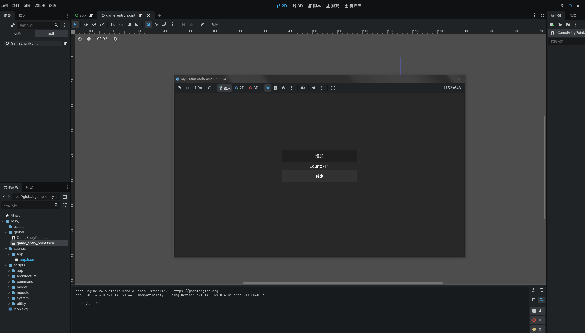

# 第 6 章：Utility 与 System

本章将引入架构的最后两个核心概念：**Utility（工具类）** 和 **System（系统）**，完成我们的架构设计。

## 新需求

### 需求 1：计数上限

计数器不能超过 **20**。

### 需求 2：阈值检查

- 当 Count > 10 时，输出提示信息
- 当 Count < -10 时，输出提示信息

## 方案一：在 Handler 中实现（❌ 不推荐）

### 错误示范

```csharp
public sealed class IncreaseCountHandler
    : AbstractRequestHandler<IncreaseCountRequest, Unit>
{
    public override ValueTask<Unit> Handle(
        IncreaseCountRequest request,
        CancellationToken cancellationToken)
    {
        var model = Context.GetModel<ICounterModel>()!;

        // ❌ 在 Handler 里写业务规则
        if (model.Count >= 20)
        {
            return ValueTask.FromResult(Unit.Value);  // 超过上限，不执行
        }

        model.Increment();
        return ValueTask.FromResult(Unit.Value);
    }
}
```

### 问题

1. **规则写死在 Handler 里**
    - 如果别的地方也要用"最大 20"的限制怎么办？
    - 规则变更（如改成 100）需要修改业务代码

2. **无法单独测试规则**
    - 只能通过 Handler 测试，无法单独测试规则逻辑

3. **违反单一职责原则**
    - Handler 应该只负责"执行操作"
    - 不应该负责"业务规则验证"

## 引入 Utility

### Utility 是什么？

**Utility（工具类）** 提供可复用的无状态逻辑，负责：

✅ 纯函数式的计算和验证  
✅ 数据转换和格式化  
✅ 业务规则的封装

Utility **不应该**：

❌ 持有状态  
❌ 依赖场景  
❌ 直接修改 Model

### 特点

- **无状态**：只提供计算方法
- **可复用**：任何层都可以调用
- **可测试**：纯函数，易于测试

### 1. 定义 Utility 接口

在 `scripts/utility/` 创建 `ICounterUtility.cs`：

```csharp
using GFramework.Core.Abstractions.Utility;

namespace MyGFrameworkGame.scripts.Utility;

/// <summary>
/// 计数器工具接口
/// </summary>
public interface ICounterUtility : IContextUtility
{
    /// <summary>
    /// 判断当前值是否可以增加
    /// </summary>
    bool CanIncrease(int current);

    /// <summary>
    /// 将值限制在有效范围内
    /// </summary>
    int Clamp(int value);
}
```

### 2. 实现 Utility 类

在 `scripts/utility/` 创建 `CounterUtility.cs`：

```csharp
using System;
using GFramework.Core.Utility;

namespace MyGFrameworkGame.scripts.Utility;

/// <summary>
/// 计数器工具实现
/// </summary>
public class CounterUtility : AbstractContextUtility, ICounterUtility
{
    private readonly int _maxCount;

    /// <summary>
    /// 构造函数
    /// </summary>
    /// <param name="maxCount">最大值（默认 20）</param>
    public CounterUtility(int maxCount = 20)
    {
        _maxCount = maxCount;
    }

    /// <summary>
    /// 初始化（可选）
    /// </summary>
    protected override void OnInit()
    {
        // 也可以通过上下文获取配置
    }

    /// <summary>
    /// 判断是否可以继续增加
    /// </summary>
    public bool CanIncrease(int current)
    {
        return current < _maxCount;
    }

    /// <summary>
    /// 将值限制在有效范围内
    /// </summary>
    public int Clamp(int value)
    {
        return Math.Clamp(value, 0, _maxCount);
    }
}
```

::: tip 为什么用构造函数传参？
这里使用构造函数传递 `maxCount` 是为了灵活性。你也可以：

- 从配置文件读取
- 通过 `architecture.Context.GetUtility()` 传入
- 硬编码在类内部

选择取决于项目需求。
:::

### 3. 注册 Utility

编辑 `scripts/module/UtilityModule.cs`：

```csharp
using GFramework.Core.Abstractions.Architecture;
using GFramework.Game.Architecture;
using MyGFrameworkGame.scripts.Utility;

namespace MyGFrameworkGame.scripts.module;

/// <summary>
/// 工具模块，负责注册所有的工具类
/// </summary>
public class UtilityModule : AbstractModule
{
    public override void Install(IArchitecture architecture)
    {
        // 注册 CounterUtility，最大值设为 20
        architecture.RegisterUtility<ICounterUtility>(new CounterUtility(maxCount: 20));
    }
}
```

### 4. 在 Handler 中使用 Utility

编辑 `IncreaseCountHandler.cs`：

```csharp
using GFramework.Cqrs.Abstractions.Cqrs;
using GFramework.Cqrs.Cqrs.Request;
using MyGFrameworkGame.scripts.Model;
using MyGFrameworkGame.scripts.Utility;

namespace MyGFrameworkGame.scripts.Cqrs;

public sealed class IncreaseCountHandler
    : AbstractRequestHandler<IncreaseCountRequest, Unit>
{
    public override ValueTask<Unit> Handle(
        IncreaseCountRequest request,
        CancellationToken cancellationToken)
    {
        var model = Context.GetModel<ICounterModel>()!;
        var utility = Context.GetUtility<ICounterUtility>()!;

        // ✅ 使用 Utility 检查规则
        if (!utility.CanIncrease(model.Count))
        {
            return ValueTask.FromResult(Unit.Value);  // 超过上限，不执行
        }

        model.Increment();
        return ValueTask.FromResult(Unit.Value);
    }
}
```

### 运行游戏

现在点击增加按钮，计数器最多只能到 **20**。

## Utility 的优势

### 1. 规则复用

假设多个地方需要检查上限：

```csharp
// Handler 中
if (!utility.CanIncrease(model.Count)) return;

// System 中
if (!utility.CanIncrease(value)) { /* ... */ }

// Controller 中
if (utility.CanIncrease(count)) { /* ... */ }
```

规则只写一次，到处可用！

### 2. 易于修改

需要改上限为 100？

```csharp
// 只需修改注册时的参数
architecture.RegisterUtility<ICounterUtility>(new CounterUtility(maxCount: 100));
```

不需要改任何业务代码！

### 3. 易于测试

```csharp
[Test]
public void CanIncrease_WhenAtMax_ReturnsFalse()
{
    var utility = new CounterUtility(maxCount: 20);
    
    Assert.IsFalse(utility.CanIncrease(20));
    Assert.IsTrue(utility.CanIncrease(19));
}
```

纯函数，测试简单！

## 引入 System

### System 是什么？

现在有个新需求：

- 当 Count > 10 时，输出提示信息 "Count 超过 10"
- 当 Count < -10 时，输出提示信息 "Count 小于 -10"

这些逻辑应该写在哪里？

**❌ 不应该在 Handler 里**：

```csharp
public override ValueTask<Unit> Handle(
    IncreaseCountRequest request,
    CancellationToken cancellationToken)
{
    model.Increment();

    // ❌ Handler 不应该关心这些"连锁反应"
    if (model.Count > 10) { /* ... */ }
    if (model.Count < -10) { /* ... */ }

    return ValueTask.FromResult(Unit.Value);
}
```

**为什么？**

- Handler 只应该关心"行为"
- 不应该关心"系统状态带来的连锁反应"

**✅ 应该在 System 里**：

**System（系统）** 负责响应状态变化，执行系统级逻辑。

### System 的职责

✅ 监听状态变化  
✅ 执行规则检查  
✅ 触发系统级反应  
✅ 协调多个 Model 的交互

System **不应该**：

❌ 直接修改 Model（应通过请求处理器）  
❌ 包含 UI 逻辑

### 1. 定义 System 接口

在 `scripts/system/` 创建 `ICounterThresholdSystem.cs`：

```csharp
namespace MyGFrameworkGame.scripts.System;

/// <summary>
/// 计数器阈值检查系统接口
/// </summary>
public interface ICounterThresholdSystem
{
    /// <summary>
    /// 检查当前计数值是否超过阈值
    /// </summary>
    void CheckThreshold(int count);
}
```

### 2. 实现 System 类

在 `scripts/system/` 创建 `CounterThresholdSystem.cs`：

```csharp
using GFramework.Core.Extensions;
using GFramework.Core.System;
using Godot;
using MyGFrameworkGame.scripts.Model;

namespace MyGFrameworkGame.scripts.System;

/// <summary>
/// 计数器阈值检查系统
/// </summary>
public class CounterThresholdSystem : AbstractSystem, ICounterThresholdSystem
{
    /// <summary>
    /// 初始化时注册事件监听
    /// </summary>
    protected override void OnInit()
    {
        // 监听计数变化事件
        this.RegisterEvent<CounterModel.ChangedCountEvent>(e =>
        {
            CheckThreshold(e.Count);
        });
    }

    /// <summary>
    /// 检查阈值
    /// </summary>
    public void CheckThreshold(int count)
    {
        if (count > 10)
        {
            GD.Print("Count 超过 10");
        }

        if (count < -10)
        {
            GD.Print("Count 小于 -10");
        }
    }
}
```

::: tip System 的生命周期
`AbstractSystem` 会在注册时自动调用 `OnInit()`，所以事件监听会在系统初始化时完成。
:::

### 3. 注册 System

编辑 `scripts/module/SystemModule.cs`：

```csharp
using GFramework.Core.Abstractions.Architecture;
using GFramework.Game.Architecture;
using MyGFrameworkGame.scripts.System;

namespace MyGFrameworkGame.scripts.module;

/// <summary>
/// 系统模块，负责注册所有的系统逻辑
/// </summary>
public class SystemModule : AbstractModule
{
    public override void Install(IArchitecture architecture)
    {
        // 注册阈值检查系统
        architecture.RegisterSystem<ICounterThresholdSystem>(new CounterThresholdSystem());
    }
}
```

### 4. 运行游戏

启动游戏，当计数超过 10 或小于 -10 时，输出面板会显示提示信息：



## System 的优势

### 1. 关注点分离

**Handler 负责"做什么"**：

```csharp
model.Increment();  // 执行操作
```

**System 负责"响应状态"**：

```csharp
if (count > 10) { /* 触发反应 */ }
```

### 2. 逻辑集中

假设将来需求变更：

- 达到 5 播放音效
- 达到 15 触发警告
- 达到 20 锁定按钮

**❌ 如果写在 Handler**：

```csharp
// 在 N 个 Handler 里重复相同逻辑
if (count == 5) PlaySound();
if (count == 15) ShowWarning();
if (count == 20) LockButton();
```

**✅ 集中在 System**：

```csharp
public void CheckThreshold(int count)
{
    if (count == 5) PlaySound();
    if (count == 15) ShowWarning();
    if (count == 20) LockButton();
}
```

只需修改一处！

### 3. 支持复杂规则

System 可以协调多个 Model：

```csharp
protected override void OnInit()
{
    // 同时监听多个事件
    this.RegisterEvent<CounterChangedEvent>(e => { /* ... */ });
    this.RegisterEvent<ScoreChangedEvent>(e => { /* ... */ });
    
    // 当两个条件同时满足时触发
    if (counter > 10 && score > 100)
    {
        UnlockAchievement();
    }
}
```

## 完整架构总览

现在我们的架构已经完整：

```text
┌─────────────┐
│    View     │  Godot UI 节点
└──────┬──────┘
       │
┌──────▼──────┐
│ Controller  │  将用户操作转为请求
└──────┬──────┘
       │
┌──────▼──────┐
│  Handler    │  封装业务逻辑
└──────┬──────┘
       │
┌──────▼──────┐
│   Model     │  存储状态，发送事件
└──────┬──────┘
       │
       ├─────────┐
       │         │
┌──────▼──────┐  │
│   Event     │  │
└──────┬──────┘  │
       │         │
┌──────▼──────┐  │
│  System     │  │  响应状态变化
└──────┬──────┘  │
       │         │
┌──────▼──────┐  │
│  Utility    │◄─┘  提供业务规则
└─────────────┘
```

### 数据流

```text
用户点击按钮
    ↓
Controller: SendAsync(IncreaseCountRequest)
    ↓
Handler: GetUtility().CanIncrease() → 检查规则
    ↓
Handler: GetModel().Increment() → 修改状态
    ↓
Model: SendEvent(ChangedCountEvent) → 发送事件
    ↓
    ├→ Controller: RegisterEvent → 更新 UI
    └→ System: RegisterEvent → 检查阈值
```

## 各层职责总结

| 层级             | 职责         | 示例                |
|----------------|------------|-------------------|
| **View**       | 呈现 UI，接收输入 | Label、Button      |
| **Controller** | 转发用户意图     | 将点击转为请求           |
| **Handler**    | 执行业务操作     | 增加计数              |
| **Model**      | 存储状态，发送事件  | 计数器的值             |
| **Event**      | 通知状态变化     | ChangedCountEvent |
| **System**     | 响应状态，执行规则  | 阈值检查              |
| **Utility**    | 提供业务规则     | 上限验证              |

## 设计原则

### 单向数据流

```text
Action → Request → Handler → Model → Event → View/System
```

- 数据总是单向流动
- 没有循环依赖
- 易于理解和调试

### 关注点分离

```text
Controller → "做什么"
Handler    → "怎么做"
Model      → "状态是什么"
System     → "状态变化后做什么"
Utility    → "规则是什么"
```

### 依赖倒置

```text
都依赖接口，不依赖具体实现

ICounterModel ← CounterModel
ICounterUtility ← CounterUtility
ICounterThresholdSystem ← CounterThresholdSystem
```

## 何时使用 Utility vs System

### Utility

✅ **无状态的计算**：

```csharp
utility.CanIncrease(count)
utility.Clamp(value)
utility.ValidateEmail(email)
```

✅ **业务规则验证**：

```csharp
if (!utility.CanPurchase(player, item)) return;
```

### System

✅ **状态驱动的逻辑**：

```csharp
if (count > 10) { /* 触发某些事情 */ }
```

✅ **协调多个 Model**：

```csharp
if (player.Level > 10 && achievement.Count > 5) { /* ... */ }
```

✅ **系统级反应**：

```csharp
PlaySound();
ShowNotification();
UpdateAchievement();
```

## 核心收获

通过本章，我们学到了：

| 概念          | 解释            |
|-------------|---------------|
| **Utility** | 无状态的业务规则和计算   |
| **System**  | 响应状态变化，执行系统逻辑 |
| **关注点分离**   | 每一层专注自己的职责    |
| **单向数据流**   | 数据流向清晰可控      |
| **事件驱动**    | 通过事件解耦组件      |

## 完整代码回顾

### 项目结构

```text
MyGFrameworkGame/
├── scripts/
│   ├── architecture/
│   │   └── GameArchitecture.cs
│   ├── module/
│   │   ├── ModelModule.cs
│   │   ├── SystemModule.cs
│   │   └── UtilityModule.cs
│   ├── model/
│   │   ├── ICounterModel.cs
│   │   └── CounterModel.cs
│   ├── cqrs/
│   │   ├── IncreaseCountRequest.cs
│   │   └── DecreaseCountRequest.cs
│   ├── utility/
│   │   ├── ICounterUtility.cs
│   │   └── CounterUtility.cs
│   ├── system/
│   │   ├── ICounterThresholdSystem.cs
│   │   └── CounterThresholdSystem.cs
│   └── app/
│       └── App.cs
├── global/
│   └── GameEntryPoint.cs
└── scenes/
    └── App.tscn
```

### 架构层次

```text
GameEntryPoint (入口)
    ↓
GameArchitecture (架构)
    ↓
Module (模块)
    ├── ModelModule → CounterModel
    ├── SystemModule → CounterThresholdSystem
    └── UtilityModule → CounterUtility
```

## 下一步

恭喜！你已经完成了基础教程的核心内容，掌握了 GFramework 的完整架构设计。

在最后一章中，我们将：

- 回顾整个架构设计
- 总结最佳实践
- 解答常见问题
- 指引下一步学习方向

👉 [第 7 章：总结与最佳实践](./07-summary.md)

---

::: details 本章检查清单

- [ ] ICounterUtility 和 CounterUtility 已创建
- [ ] Utility 已注册到 UtilityModule
- [ ] IncreaseCountHandler 使用 Utility 检查规则
- [ ] ICounterThresholdSystem 和 CounterThresholdSystem 已创建
- [ ] System 已注册到 SystemModule
- [ ] 运行游戏，计数最大为 20
- [ ] 超过阈值时能看到提示信息
- [ ] 理解了 Utility 和 System 的职责区别
  :::

::: tip 思考题

1. 如果需要在多个 System 之间通信，应该怎么做？
2. Utility 和 System 哪个应该先注册？为什么？
3. 如何实现"计数为偶数时播放音效"的功能？

这些问题会在进阶教程中探讨！
:::
