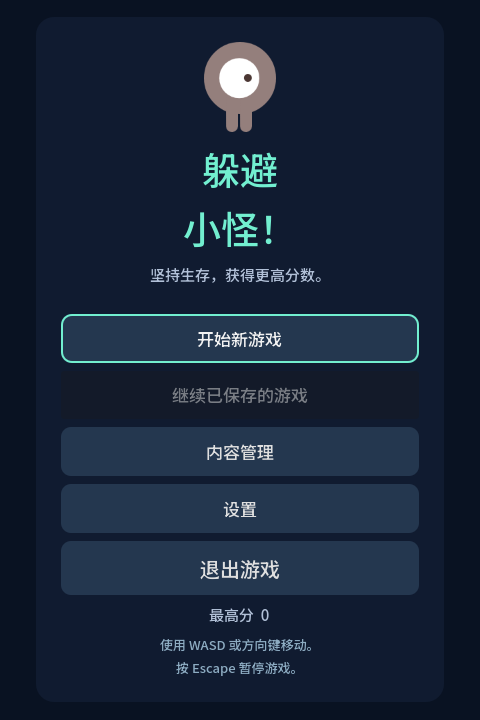
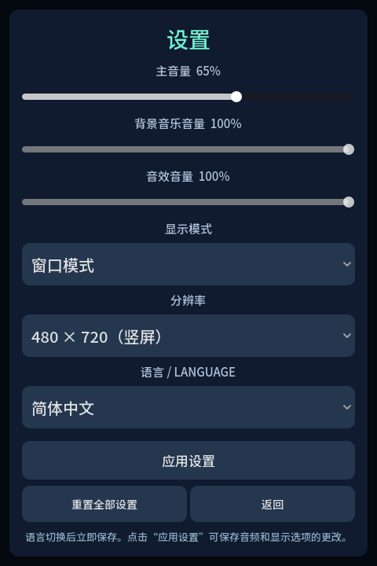
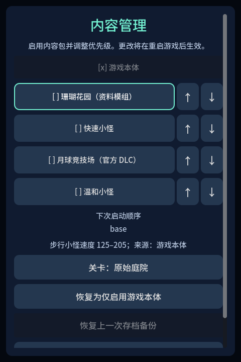

# 制作官方素材小游戏：Dodge the Creeps

本教程按实际制作顺序，使用 [Godot 官方首个 2D 游戏教程](https://docs.godotengine.org/en/stable/getting_started/first_2d_game/index.html) 的素材，组装一款移动躲避、生存计分的小游戏。角色、敌人和动画使用 Godot 原生节点；GFramework 承接场景、UI、暂停、存档和异步关闭。

完成后可以操作主菜单、新游戏、暂停、设置、保存继续、放弃确认和结束画面。完整工程位于 [小游戏源码](https://github.com/GeWuYou/GFramework/tree/main/Samples/DodgeTheCreeps)。



## 准备环境与工作目录 {#prepare}

需要 C# 的类、事件、泛型和 `async/await` 基础，以及 Godot 的节点、信号和输入映射概念。准备 Godot **4.7.2 .NET** 与能够构建仓库目标框架的 **.NET SDK 10**；示例游戏本身使用 `net8.0`。引擎版本与项目的 `Godot.NET.Sdk`、框架的 GodotSharp 引用保持一致。

在工作区克隆框架，并在旁边创建练习工程：

```bash
git clone https://github.com/GeWuYou/GFramework.git GFramework
```

```text
workspace/
├─ GFramework/          # 框架源码及完整样例
└─ DodgeTheCreeps/      # 在 Godot 中新建的练习工程
```

下文的终端命令均从这个工作区根目录执行。`godot` 表示本机 Godot .NET 可执行文件；`res://` 表示练习工程根目录。

想先观察完成后的效果，可以运行仓库样例：

```bash
python3 GFramework/scripts/build-dodge-mods.py
dotnet build GFramework/Samples/DodgeTheCreeps/DodgeTheCreeps.csproj -c Debug
godot --editor --path GFramework/Samples/DodgeTheCreeps
```

正文的关键片段直接引用可编译样例中的命名区段。片段位于相应类内部；组装时保留完整文件中的 `using`、字段和辅助方法。每个制作阶段都提供完整源码入口，便于逐步对照。

## 一、建立主场景与项目引用 {#project}

在 Godot 项目管理器中新建 `DodgeTheCreeps`，选择 Compatibility 渲染器。创建 `Node` 根节点，保存为 `Main.tscn`，挂载 C# 脚本 `DodgeApp.cs`，将 `Main.tscn` 设为主场景。

在项目设置中确认：

| 设置 | 值 |
| --- | --- |
| Viewport Width / Height | `480` / `720` |
| Window Width / Height Override | `480` / `720` |
| Stretch Mode | `canvas_items` |
| .NET Assembly Name | `DodgeTheCreeps` |
| Main Scene | `res://Main.tscn` |

项目文件沿用样例的配置：

<<< ../../../Samples/DodgeTheCreeps/DodgeTheCreeps.csproj{xml}

上面的引用路径用于仓库内的样例。按本教程的并列目录布局，将样例中的五项引用改为：

```xml
<ItemGroup>
  <ProjectReference Include="../GFramework/GFramework.Godot/GFramework.Godot.csproj"/>
  <ProjectReference Include="../GFramework/GFramework.Game.Abstractions/GFramework.Game.Abstractions.csproj"/>
  <ProjectReference Include="../GFramework/GFramework.Core.Abstractions/GFramework.Core.Abstractions.csproj"/>
  <ProjectReference Include="../GFramework/GFramework.Game.Harmony/GFramework.Game.Harmony.csproj"/>
  <ProjectReference Include="../GFramework/Samples/DodgeTheCreeps.ModApi/DodgeTheCreeps.ModApi.csproj"/>
</ItemGroup>
```

主场景只需要挂载启动脚本：

<<< ../../../Samples/DodgeTheCreeps/Main.tscn{ini}

先保留 Godot 生成的空 `DodgeApp : Node` 脚本，执行：

```bash
dotnet build DodgeTheCreeps/DodgeTheCreeps.csproj -c Debug
godot --path DodgeTheCreeps
```

**检查点：** 窗口正常打开，C# 脚本可编译，主场景可找到。此时画面为空。

## 二、准备官方美术、声音与字体 {#assets}

从官方教程下载 [Dodge the Creeps 素材包](https://github.com/godotengine/godot-docs-project-starters/releases/download/latest-4.x/dodge_the_creeps_2d_assets.zip)，解压后把 `art/`、`fonts/` 放到练习工程根目录。

| 文件 | 用途 |
| --- | --- |
| `playerGrey_walk1.png`、`playerGrey_walk2.png` | 玩家横向移动 |
| `playerGrey_up1.png`、`playerGrey_up2.png` | 玩家纵向移动 |
| `enemyWalking_*.png`、`enemySwimming_*.png`、`enemyFlyingAlt_*.png` | 三种敌人外观 |
| `House In a Forest Loop.ogg`、`gameover.wav` | 背景音乐与结束音效 |
| `Xolonium-Regular.ttf` | 菜单字体 |

文件名与大小写保持原样，游戏通过 `res://art/...` 和 `res://fonts/...` 加载。让编辑器完成资源导入。

保留字体原有的许可证和说明，并从完整样例保留 `ASSETS.md` 与 `art/LICENSE-MIT.txt`。图片使用 Kenney 的 CC0 素材，音乐需保留 HorrorPen 的 CC-BY 3.0 署名，字体遵循 OFL。分发要求集中在 [素材署名与许可](https://github.com/GeWuYou/GFramework/blob/main/Samples/DodgeTheCreeps/ASSETS.md)。

**检查点：** 在 FileSystem 中能预览 PNG，播放音频，并找到字体资源。

## 三、实现玩家移动与动画 {#player}

先建立 `Gameplay/`。这个阶段完成以下五个文件，再运行玩法预览：

| 文件 | 责任与完整源码 |
| --- | --- |
| `DodgeSpriteFrames.cs` | [把原始图片组成动画](https://github.com/GeWuYou/GFramework/blob/main/Samples/DodgeTheCreeps/Gameplay/DodgeSpriteFrames.cs) |
| `DodgePlayer.cs` | [玩家节点、移动与保护指示](https://github.com/GeWuYou/GFramework/blob/main/Samples/DodgeTheCreeps/Gameplay/DodgePlayer.cs) |
| `DodgeMob.cs` | [敌人节点、外观与速度](https://github.com/GeWuYou/GFramework/blob/main/Samples/DodgeTheCreeps/Gameplay/DodgeMob.cs) |
| `DodgeWorld.cs` | [生成、更新、计分与碰撞](https://github.com/GeWuYou/GFramework/blob/main/Samples/DodgeTheCreeps/Gameplay/DodgeWorld.cs) |
| `ScoreChangedEventArgs.cs` | [分数变化事件数据](https://github.com/GeWuYou/GFramework/blob/main/Samples/DodgeTheCreeps/Gameplay/ScoreChangedEventArgs.cs) |

保留源码中的 `DodgeTheCreeps.Gameplay` 命名空间。可以先复制完整实现作为起点，再按本节和下一节逐项调整。

当前玩法源码也包含内容包和完整快照接入口。将样例的 `Content/`、`Modding/`、`DodgeProgress.cs` 和 `OfficialPackTrust.cs` 一并复制到练习工程，并保留 `Gameplay/` 中的敌人快照类型，使这些类型可编译；本阶段的预览脚本不创建内容会话，仍使用默认的敌人参数。完整内容启动在第六步接入。

### 输入动作

在 Project Settings → Input Map 中添加四个动作及按键：

| 动作 | 按键 |
| --- | --- |
| `dodge_left` | A、左方向键 |
| `dodge_right` | D、右方向键 |
| `dodge_up` | W、上方向键 |
| `dodge_down` | S、下方向键 |

这些动作供世界移动使用。菜单导航继续使用 Godot 的 `ui_*` 动作。完成工程中的 `ConfigureInput` 会补齐尚未存在的游戏动作；已经在编辑器建立的动作保留原有绑定。

### 玩家节点

`DodgePlayer._Ready` 创建 `AnimatedSprite2D`，将四张玩家图片组成 `walk` 和 `up` 动画。`Advance` 读取输入、按 `delta` 更新坐标并限制边界：

<<< ../../../Samples/DodgeTheCreeps/Gameplay/DodgePlayer.cs#tutorial-movement{csharp}

输入向量归一化，因此斜向不会比横向移动更快。移动朝向仍分为八个方向，动画按官方素材使用横向与向上两组帧，通过翻转表现四向。斜向移动使用横向动画，不旋转角色；停止后保留最后姿态。保护期只让角色闪烁，不绘制额外圆环。

## 四、实现敌人、计分与碰撞 {#world}

`DodgeWorld._Ready` 创建玩家、背景音乐播放器和结束音效播放器。世界进入场景树后，`StartRun` 才能访问这些节点。

### 统一更新

世界用一个暂停感知的物理更新驱动移动、生成和碰撞，玩家与敌人的 `Advance` 由它调用：

<<< ../../../Samples/DodgeTheCreeps/Gameplay/DodgeWorld.cs#tutorial-loop{csharp}

`AdvanceScore` 累加未暂停的 `delta`，每满一秒增加一分，通过 `ScoreChanged` 通知界面。`IsRunning` 控制一局是否继续更新。

### 从边缘生成敌人

先在屏幕外的四条边选择出生点，再朝场内随机目标移动。生成时确定速度、外观和方向：

<<< ../../../Samples/DodgeTheCreeps/Gameplay/DodgeWorld.cs#tutorial-spawn{csharp}

首次生成留出准备时间。分数提高后缩短生成间隔、增加速度，并用下限和上限控制难度增长。`DodgeMob` 负责原生动画，世界负责其运动与移除。

### 碰撞与结束

每帧移除离开有效区域的敌人，并比较玩家与敌人的圆形距离：

<<< ../../../Samples/DodgeTheCreeps/Gameplay/DodgeWorld.cs#tutorial-collision{csharp}

保护时间结束后，距离小于两个碰撞半径之和时调用 `EndRun`。它先停止本局，再播放结束音效并发出一次 `RunEnded`。

本局结束后，应用清除当前存档及备份恢复入口，再显示结束页面。回到主菜单时“继续游戏”禁用，设置和最高分仍然保留。

`RunEnded` 由 `DodgeApp.GameOverAsync` 观察。该流程等待以下清理完成后再显示结束页面；删除失败时显示错误，并阻止当前会话继续已结束的存档：

<<< ../../../Samples/DodgeTheCreeps/DodgeApp.cs#tutorial-run-save-retirement{csharp}

### 先跑玩法预览

暂时将 `DodgeApp.cs` 写为下面的预览脚本：

```csharp
using DodgeTheCreeps.Gameplay;
using Godot;

namespace DodgeTheCreeps;

public partial class DodgeApp : Node
{
    public override void _Ready()
    {
        var world = new DodgeWorld { Name = "World" };
        AddChild(world);
        world.StartRun();
    }
}
```

重新构建并运行。

**检查点：** 玩家能移动且留在场内，敌人从边缘出现，碰撞后这一局停止。这个阶段可以通过编辑器 Remote 场景树查看原生节点；第六步会替换这份预览脚本。

## 五、定义页面、窗口和数据 {#routes}

完整应用按下列文件分工：

```text
DodgeTheCreeps/
├─ Main.tscn
├─ DodgeApp.cs                 # 服务装配与游戏业务流程
├─ DodgeApp.Smoke.cs           # 同一个 partial 类型中的原生自检
├─ DodgeApp.Content.cs         # 文档转换、内容检查与确认提交
├─ DodgeApp.Mods.cs            # 模组独立 API 与状态作用域
├─ DodgeApp.ContentSmoke.cs    # 内容跨进程自检
├─ DodgeApp.Settings.cs        # 设置应用、回滚与持久化
├─ DodgeApp.*Smoke.cs          # 朝向、完整存档及设置验收
├─ DodgeRoutes.cs              # 路由定义
├─ DodgeMenus.cs               # 原生视图和按钮
├─ DodgeMenus.Content.cs       # 内容管理与恢复对话框
├─ DodgeMenus.Settings.cs      # 音频、显示、语言与未应用草稿
├─ OfficialPackTrust.cs        # 游戏拥有的官方 PCK 摘要
├─ DodgeProgress.cs            # 当前局存档
├─ DodgeProgressMigration.cs   # 文档升级与显式降级
├─ DodgePreferences.cs         # 音量、全屏、最高分
├─ Gameplay/
├─ Content/                   # 敌人／关卡定义和内容会话
├─ Modding/                   # 内部计分补丁目标
├─ content_sources/           # 本体和可选内容包
├─ content-schemas/           # 游戏拥有的 schema
├─ Localization/              # 框架本地化接线及中英文本
├─ art/
└─ fonts/
```

把样例的 `content_sources/`、`content-schemas/`、`Localization/`、`official-pack/` 和 `build-official-pack.gd` 复制到练习工程。字体目录同时保留 Noto Sans SC 字体、OFL 许可和原有字体，确保中文在导出程序中也有字形。已提供的官方资源包与 `OfficialPackTrust.cs` 对应，不需要玩家重新生成摘要；开发者修改源场景后才重新运行打包脚本。

### 路由定义

在 `DodgeRoutes` 中一次声明参数类型和交互策略，注册与调用复用这些定义：

<<< ../../../Samples/DodgeTheCreeps/DodgeRoutes.cs{csharp}

| 界面 | 组织方式 | 参数与行为 |
| --- | --- | --- |
| 主菜单 | 页面 | `bool` 表示是否允许继续存档 |
| HUD | 独立窗口 | `int` 初始分数；不捕获返回动作 |
| 暂停 | 模态窗口 | `int` 当前分数；持有暂停请求 |
| 设置 | 模态窗口 | 独立暂停请求，显示在暂停菜单上方 |
| 内容管理 | 模态窗口 | 管理可选包、下次启动顺序和当前关卡 |
| 内容恢复 | 结果对话框 | 展示差异；玩家确认后备份并恢复存档 |
| 放弃确认 | 结果对话框 | `Func<string>` 提供当前语言的提问，返回 `bool` |
| 结束画面 | 页面 | `int` 本局分数 |

`Layer` 确定展示顺序。`Modal`、世界输入阻断和 `PauseWhileVisible` 分别决定交互与暂停。HUD 的 `AllowBack = false`、`CapturedActions = None` 使它能持续展示而不截获返回。

### 存档与偏好

当前局 DTO 保存可序列化的数值和稳定关卡 ID，不保存原生节点。框架在外层 `SaveDocument` 中保存结构版本、内容包快照和模组状态：

<<< ../../../Samples/DodgeTheCreeps/DodgeProgress.cs{csharp}

每个敌人的快照保存稳定内容 ID 和可恢复的数值状态：

<<< ../../../Samples/DodgeTheCreeps/Gameplay/DodgeMobProgress.cs{csharp}

偏好数据保存三路音量、显示模式、竖屏尺寸、语言和最高分：

<<< ../../../Samples/DodgeTheCreeps/DodgePreferences.cs{csharp}

v2 存档同时保存敌人 ID、数量、位置、速度、外观、动画进度，玩家朝向，计分余量、下次生成时间、剩余保护时间，以及随机生成器的 seed/state。继续游戏恢复该局面，不重新随机生成敌人，也不额外增加保护时间。新局保持为内存状态，玩家明确保存后才更新槽位。

结构转换在创建当前 DTO 之前处理独立文档；游戏提供每个方向的转换逻辑，准备后经显式提交备份并写入：

<<< ../../../Samples/DodgeTheCreeps/DodgeProgressMigration.cs{csharp}

## 六、装配框架服务并注册原生视图 {#services}

用 [完整启动脚本](https://github.com/GeWuYou/GFramework/blob/main/Samples/DodgeTheCreeps/DodgeApp.cs) 替换第四步的预览脚本。复制样例根目录的全部 `*.cs`、`Localization/`、`Modding/` 及前面列出的数据和素材目录，保留同一 `partial DodgeApp`、`partial DodgeMenus` 的全部伴随文件。普通启动也调用其中的设置、内容、翻译及参数解析方法，不能只复制正文展示的代码片段。

### 在原生线程创建服务

以下接线位于 `DodgeApp._Ready`。根节点进入树后捕获宿主同步上下文，随后创建场景、UI 和输入桥：

<<< ../../../Samples/DodgeTheCreeps/DodgeApp.cs#tutorial-services{csharp}

`DodgeApp` 实现 `ISceneRoot`，把场景行为的原生对象挂到自身，并在清理时分离。它的 `WorldFactory.Create` 创建 `DodgeWorld`、连接计分与结束事件，再用 `SceneBehaviorFactory.Create` 包装。

`GodotUiRoot` 提供 UI 容器和焦点处理。`GodotPauseHandler` 将共享暂停管理器连接到场景树。`GodotUiInputBridge` 把未处理的 Escape 交给 UI；没有界面捕获时，执行打开暂停菜单的业务动作。

### 一处登记全部视图

`DodgeMenus` 用普通 `Control` 工厂登记视图。参数和关闭上下文随工厂进入：

<<< ../../../Samples/DodgeTheCreeps/DodgeMenus.cs#tutorial-register{csharp}

布局辅助方法 `Page`、`Title`、`Caption` 和 `Button` 负责一致的容器、字体和样式。完整菜单源码包含这些方法，创建新界面时可复用它们。

### 加载数据后显示主菜单

启动流程先创建存储与槽位仓库，读取偏好，最后决定 Continue 是否可用：

<<< ../../../Samples/DodgeTheCreeps/DodgeApp.cs#tutorial-load-data{csharp}

这时重新构建练习工程。

**检查点：** 主菜单出现，字体和美术可见；首次运行 Continue 处于禁用状态；设置能打开并返回。

## 七、连接按钮、HUD 与新游戏 {#start-game}

### 观察异步按钮操作

按钮把工作交给 `RunAction`，执行期间禁用自己，结束后恢复可用。Quit 使用独立的关闭边界：

<<< ../../../Samples/DodgeTheCreeps/DodgeMenus.cs#tutorial-buttons{csharp}

启动脚本保存并观察动作任务，统一展示错误：

<<< ../../../Samples/DodgeTheCreeps/DodgeApp.cs#tutorial-actions{csharp}

保留任务供关闭流程等待，可以避免保存尚未结束就释放底层资源。原生信号边界以外的业务方法保持返回 `Task`。

### 新游戏与继续游戏

`StartGameAsync` 先取得需要恢复的数据，再切换场景，最后显示 HUD：

<<< ../../../Samples/DodgeTheCreeps/DodgeApp.cs#tutorial-start-game{csharp}

`await _scenes.ReplaceAsync` 完成后，世界已经挂载并执行 `_Ready`，此时才能调用 `StartRun` 或 `RestoreProgress`。保存内容和动画记录的校验发生在替换场景之前；世界还会先准备全部敌人，再提交棋盘，避免失败时留下半个局面。

世界的 `ScoreChanged` 通过启动脚本更新 HUD；`RunEnded` 触发结束流程，保存最高分并显示带本局分数的结束页。最高分写入失败时，结束画面的重试和返回操作仍可使用。

**检查点：** New run 进入游戏，HUD 分数按生存时间变化；碰撞后出现结束画面，Try again 能开始新一局。

## 八、接入嵌套暂停与设置 {#pause-settings}

`DodgeWorld` 使用 `Pausable`，启动脚本和菜单能在暂停期间继续处理操作。可见的暂停窗口持有一份暂停请求，设置窗口再持有一份。

设置界面从当前偏好建立局部草稿：

<<< ../../../Samples/DodgeTheCreeps/DodgeMenus.Settings.cs#tutorial-settings{csharp}

保存时先写入新偏好，再替换内存数据并应用音量、全屏：

<<< ../../../Samples/DodgeTheCreeps/DodgeApp.Settings.cs#tutorial-save-settings{csharp}

设置包含总音量、音乐、音效，窗口／全屏，以及 360×540、480×720、640×960 三档竖屏分辨率。逻辑画布保持 480×720，窗口按可用屏幕区域限制并保持比例。音乐和音效分别进入 BGM、SFX 总线，再受 Master 总音量控制；滑块为零时真正静音。



语言支持 English 与简体中文，首次按系统语言选择，不支持的语言回退英文。语言选择立即保存并刷新现有界面；其余设置先编辑副本，应用后保存。返回或 Escape 遇到未应用修改时，可以应用、放弃或继续编辑。重置填入默认音频和显示值并恢复默认语言，最高分、存档和内容包选择保持独立。

`DodgeLocalization` 复用框架 `LocalizationManager`，并将框架语言映射到 Godot locale。界面通过随节点退出自动解绑的订阅刷新文本和字体，不清空路由栈，因此切换语言不会丢失暂停、对话框或输入焦点。对话框使用文本提供函数，让已经打开的确认信息也能更新。翻译表与具名占位符在启动时校验，中文字体随工程分发。[Godot 本地化指南](https://docs.godotengine.org/en/stable/tutorials/i18n/internationalizing_games.html)

关闭设置时通过实例上下文关闭准确的窗口，服务释放它自己的暂停请求；下面的暂停菜单仍然持有请求。

**检查点：** 游戏中按 Escape，角色、敌人和计分停止；打开设置、保存并返回后仍保持暂停；再恢复游戏才继续更新。关闭后重开设置，草稿从已保存偏好重新建立。

## 九、保存继续与确认结果 {#save-confirm}

### 显式保存当前局

玩家点击保存时，将世界状态转换为 DTO，再交给槽位仓库：

<<< ../../../Samples/DodgeTheCreeps/DodgeApp.cs#tutorial-save-game{csharp}

游戏进度保存在 `user://dodge_the_creeps/saves/slot_1/save.json`，偏好保存在 `user://dodge_the_creeps/preferences.json`。资源加载使用 `res://`，可变数据使用 `user://`。

### 用返回值处理放弃确认

确认视图直接通过 `UiDialogContext<bool>` 提交选择：

<<< ../../../Samples/DodgeTheCreeps/DodgeMenus.cs#tutorial-confirm{csharp}

业务流程等待结果，接受放弃后才清理世界并回到主菜单：

<<< ../../../Samples/DodgeTheCreeps/DodgeApp.cs#tutorial-confirm-exit{csharp}

这里的 `Accepted` 表示对话框提交了业务结果，`Value` 表示玩家的选择。Keep playing 提交 `false`；关闭对话框得到未接受结果；只有明确提交 `true` 才执行放弃。

**检查点：** 新局返回菜单时，Keep playing 保留当前局；选择放弃后返回菜单。暂停一局并记录敌人的数量和位置，保存、退出，再打开并 Continue，应恢复同一局面。计时器和随机状态也随快照恢复，避免读档重新抽取后续生成；随机生成器先恢复 seed，再恢复原 state。[Godot 存档指南](https://docs.godotengine.org/en/stable/tutorials/io/saving_games.html)、[随机状态恢复约定](https://docs.godotengine.org/en/stable/classes/class_randomnumbergenerator.html)

### 内容包与存档兼容

主菜单的 Content 管理本体、官方 Moon DLC 和资料模组。启停与排序保存为下次启动配置，不改变当前局；重启后显示最终敌人速度及其来源。资料型模组可以追加敌人与关卡，玩法由游戏已有模板解释。

继续游戏前先准备文档版本转换与内容检查。缺失 DLC 时可以取消并重新启用原包，或确认游戏准备的修复结果：将缺失关卡替换为本体关卡，提交时框架备份原始文件并原子写入。长诊断可以滚动，恢复按钮保持可见。完整包格式、依赖、字段补丁、版本转换和备份恢复见 [DLC 与资料型模组](../game/content-packs.md)。

## 十、等待服务与原生资源完成关闭 {#shutdown}

窗口关闭和 Quit 按钮连接到 `RequestQuit`，先关闭新操作入口、取消等待，再等待动作与服务停止。Quit 按钮单独连接关闭边界，避免把关闭操作加入它自己等待的动作集合。

::: details 完整关闭实现

<<< ../../../Samples/DodgeTheCreeps/DodgeApp.cs#tutorial-shutdown{csharp}

:::

服务停止期间保留原生根节点；页面回调和存档写入有机会完成。UI 和场景清理后，等待排队的节点释放及音频混音线程归还播放引用，再释放主题、存储和取消源。

`DodgeWorld._ExitTree` 解除音乐事件订阅、停止播放并释放它拥有的随机数对象。普通 UI 场景有业务订阅时，可用 `IGodotUiLifecycle` 在打开时登记、关闭时解绑，具体接法见 [Godot UI 生命周期](../godot/ui.md#可选生命周期)。

**检查点：** 游戏中或暂停时关闭窗口、主菜单点击 Quit、保存后立即退出都能正常结束；重新运行仍可读取已明确保存的内容。

## 十一、构建、原生自检与桌面导出 {#export}

在练习工程中保留完整样例的 `DodgeTheCreeps.sln` 和 `export_presets.cfg`。独立解决方案中的项目名、项目文件和程序集名称保持一致，并包含 `Debug`、`Release`、`ExportDebug`、`ExportRelease` 映射。

先构建并导入资源：

```bash
dotnet build DodgeTheCreeps/DodgeTheCreeps.csproj -c Release
dotnet build DodgeTheCreeps/DodgeTheCreeps.csproj -c Debug
godot --headless --editor --path DodgeTheCreeps --import
godot --headless --path DodgeTheCreeps -- --smoke
```

原生自检输出 `DODGE_SMOKE_RESULT PASS` 和一份 `DODGE_SMOKE_DATA <GUID>`。用该标识启动新进程：

```bash
godot --headless --path DodgeTheCreeps -- --smoke-continue=<上一轮的GUID>
```

这组自检覆盖移动、暂停、保存继续及死亡清档；`--smoke-continue` 确认重启后已结束的存档不可继续，设置和最高分仍保留。完整棋盘的跨进程恢复使用另一组入口：

```bash
godot --headless --path DodgeTheCreeps -- --persistence-smoke
godot --headless --path DodgeTheCreeps -- --persistence-smoke-continue=<上一轮输出的GUID>
```

该组比较敌人、计时、朝向、随机状态和后续生成，并检查无法直接反序列化为当前 DTO 的 v3 文档在降级准备、取消和备份提交时的行为。所有自检均使用独立数据目录，调用方设置进程超时并检查退出码与 `DODGE_SMOKE_RESULT PASS`。

代码模组使用 `--modding-smoke`，再按 `DODGE_MODDING_NEXT` 输出的 GUID 连续运行三次 `--modding-smoke-continue=<GUID>`。它通过真实授权对话框和外部 DLL 检查拒绝／允许、重启生效、计分与状态保存、缺失模组数据保留、重新启用及独立清理；每阶段检查 `DODGE_MODDING_RESULT PASS`。运行前先执行 `python3 GFramework/scripts/build-dodge-mods.py` 并把暂存包复制到练习工程。

安装与引擎同版本的 .NET 导出模板，在练习工程中建立 `exports/`，然后执行：

```bash
godot --headless --path DodgeTheCreeps --export-release "Windows Desktop"
godot --headless --path DodgeTheCreeps --export-release "Linux Desktop"
```

分发时保留可执行文件、`.pck`、对应的 `data_DodgeTheCreeps_*` 目录，以及素材署名和许可证。导出程序支持相同的普通、持久化及代码模组自检参数。

最后实际操作移动、暂停、焦点切换、设置、保存继续、重试和退出，检查窗口缩放、文字可读性、音量与游戏手感。

需要记录主菜单画面时，可运行 `godot --path DodgeTheCreeps -- --capture-menu=<PNG绝对路径>`，程序会保存画面并正常退出。

## 十二、扩展 DLC 与资料型模组 {#content-extension}

示例自带四个默认停用的可选包，复制安装后由同一个内容会话加载：

| 包 | 可观察效果 |
| --- | --- |
| Moon Arena | 官方 PCK 提供月面装饰场景，新增可选月面关卡 |
| Coral Garden | 资料模组新增敌人与关卡，携带原始 PNG 和 OGG 素材 |
| Fast Creeps | 修改本体敌人的速度字段 |
| Gentle Creeps | 修改同一字段，用来观察加载顺序与来源 |



打开 Content，启用 Moon 和 Coral，重启后切换关卡并开始新局。然后同时启用两个速度包，通过上下按钮改变顺序并重启，观察最终 walker 速度和来源。依赖必须先加载，其余由玩家排序；保存待生效选择不改变正在进行的游戏。

### 创建一个字段补丁包

在 `user://dodge_the_creeps/content/installed/practice-speed/` 创建清单和 YAML。路径在内容管理界面及示例说明中提供，包根目录必须直接包含清单。

```json
{
  "formatVersion": 2,
  "id": "practice-speed",
  "name": "Practice Speed",
  "version": "1.0.0",
  "gameId": "dodge-the-creeps",
  "dependencies": [{ "id": "base" }],
  "contentFiles": ["patch.yaml"]
}
```

```yaml
- op: patch
  table: enemies
  id: base:walker
  value:
    speedMin: 170
    speedMax: 210
```

重启后勾选该包，并将它排在其他速度包之后；再次重启，管理界面应显示 170–210 及 `practice-speed` 来源。未知字段、非法取值和缺失引用会报告具体包与字段。新增敌人、关卡可以参考 `content_sources/coral/` 的 `add` 操作；玩家安装的原始素材使用正常 `.png`、`.ogg` 后缀，仓库示例中的 `.source` 后缀只用于保留导出前的原始媒体。

### 官方资源包与存档兼容

Moon 源场景位于 `official-pack/`。开发者修改后，可在练习工程重新生成 PCK 与游戏信任摘要，再构建：

```bash
godot --headless --path DodgeTheCreeps --script build-official-pack.gd
dotnet build DodgeTheCreeps/DodgeTheCreeps.csproj -c Debug
```

固定摘要由游戏拥有，不能通过把第三方包标为“官方”绕过校验。资料型模组只使用数据和安全媒体入口。代码模组另走 DLL 授权与生命周期入口，完整构建、安装、API 和 Harmony 接线见[代码模组与 Harmony](../game/code-mods.md)。

### 独立代码模组

运行 `python3 GFramework/scripts/build-dodge-mods.py`，分别编译 `DodgeTheCreeps.BonusMod` 与 `DodgeTheCreeps.HarmonyMod`，并暂存模组自己的 DLL 和依赖描述。将生成的 `GFramework/Samples/DodgeTheCreeps/content_sources/code-bonus/`、`code-double/` 完整目录复制到练习工程的 `content_sources/`，完成后重启，尚未安装过的代码示例会被补装。主游戏只引用共享 API 和可选 Harmony，不引用示例模组实现项目。

Content 中启用代码包时确认代码执行权限，重启后观察计分：Bonus 每次额外加 1，Double 修改内部基础结果乘 2，两者同时启用时每次加 3。保存并重启继续，Bonus 的累计次数随模组独立数据区恢复。代码包更新后重新确认精确版本和指纹。

宿主和模组共享的最小接口：

<<< ../../../Samples/DodgeTheCreeps.ModApi/IDodgeModApi.cs{csharp}

游戏将该接口绑定到对应模组的数据作用域，代码包不能通过自己的作用域参数选择另一个 owner。纯资料包仍走受限素材入口，代码授权不替代官方 PCK 校验。


保存月面关卡后停用 Moon，再重启并继续游戏，会出现依赖差异。可以取消并重新启用原包，或确认准备好的结果并备份提交到本体关卡；只有缺失内容提供的敌人才被移除，有效敌人状态继续保留。恢复按钮可以找回原始文件，之后仍需满足其内容依赖。包格式、合并规则和通用接入见 [DLC 与资料型模组](../game/content-packs.md)。

## 常见问题

| 现象 | 检查位置 |
| --- | --- |
| 玩家不能移动 | 四个 `dodge_*` 动作及按键绑定；世界是否已调用 `StartRun` |
| 重开时提示世界尚未挂载 | 先 `AddChild` 或等待场景替换，再开始本局 |
| 菜单关闭后仍暂停 | 检查下面是否还有可见暂停窗口或设置窗口 |
| 界面出现但点击没有作用 | 视图注册、原生层级和按钮是否交给 `RunAction`；查看错误提示 |
| 继续游戏不可用 | 是否已保存尚未结束的局面；死亡后该槽位会清除 |
| 导出找不到程序集 | 独立解决方案、程序集名、SDK 与 Export 配置映射 |
| 导出程序能启动但素材缺失 | 资源导入结果、资源路径和完整的导出目录 |

## 后续练习

新增一个带参数页面，或为实时数据展示加入打开订阅、关闭解绑；调整暂停菜单中的设置，并验证多层窗口返回规则。框架入口分别见 [通用 UI](../game/ui.md)、[场景服务](../game/scene.md)、[暂停实践](./pause-system.md) 和 [存档实践](./save-system.md)。
